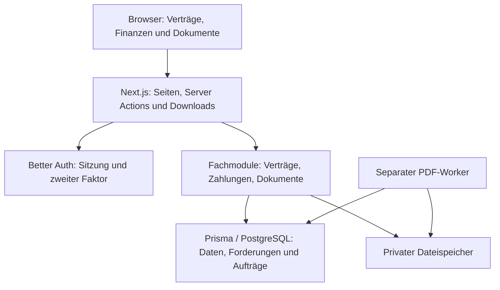

# Architektur

Die Webanwendung nutzt den Next.js App Router unter Node.js. PostgreSQL speichert Fach- und Sitzungsdaten. Prisma-Migrationen definieren das Schema. Ein separater Worker liest PDF-Aufträge aus derselben Datenbank. Dokumente und fertige Berichte liegen im privaten Dateispeicher.

`src/app` enthält Seiten, Server Actions und Downloads. Wiederverwendbare UI-Bausteine liegen in `src/components`, die Fachlogik in `src/modules` und die technische Infrastruktur in `src/lib`. Die Fachmodule decken unter anderem Stammdaten, Verträge, Finanzen, Dokumente, Berichte, Ankauf und Bankmappen ab.

## Entscheidung zur Authentifizierung

Auth.js wurde für Passwortanmeldung mit persistenten, widerrufbaren Sitzungen geprüft. Der Credentials-Provider der stabilen NextAuth-Linie verlangt JWT-Sitzungen. Die Auth.js-Dokumentation überlässt dem Anwender zudem Passwortverwaltung und Ratenbegrenzung. Für diesen Funktionsumfang verwenden wir Better Auth mit Prisma-Adapter, Datenbanksitzungen, Passwortanmeldung, TOTP und Wiederherstellungscodes. Passwort-Hashing und Authentifizierungsprotokolle bleiben in der Bibliothek.

- [NextAuth Credentials](https://next-auth.js.org/providers/credentials)
- [Auth.js Credentials](https://authjs.dev/getting-started/authentication/credentials)
- [Better Auth Prisma](https://better-auth.com/docs/adapters/prisma)
- [Better Auth Zwei-Faktor-Plugin](https://better-auth.com/docs/plugins/2fa)
- [Prisma 7](https://docs.prisma.io/docs/guides/upgrade-prisma-orm/v7)
- [Next.js App Router](https://nextjs.org/docs/app/getting-started/installation)

## Stammdaten

Listen und Detailseiten prüfen die Sitzung und den zweiten Faktor vor dem Datenzugriff. Die Server Actions prüfen zusätzlich die Administratorrolle, validieren Formulardaten mit Zod und rufen die Fachservices auf. Betrachter haben Lesezugriff. Die Fachservices kapseln Transaktionen und Geschäftsregeln. Mutationen und zugehörige Auditereignisse werden gemeinsam festgeschrieben.

## Finanzen, private Dateien und Worker

Dashboard, Finanzübersicht und PDF-Berichte nutzen denselben Finanzservice. Der Server hält Geld in Decimal. Zeitabhängige Buchungen und Zuordnungen bewahren ihre Originalwerte. Dokumentmetadaten und Jobstatus liegen in PostgreSQL, Binärdateien in privaten Verzeichnissen. Der Worker übernimmt Jobs atomar, rendert isoliertes HTML und schreibt Ergebnisse nur für den noch gültigen Versuch fest. Außerdem erzeugt er Forderungen für den laufenden Monat einmal pro Berliner Kalendertag.

## Anwendung und PDF-Worker

